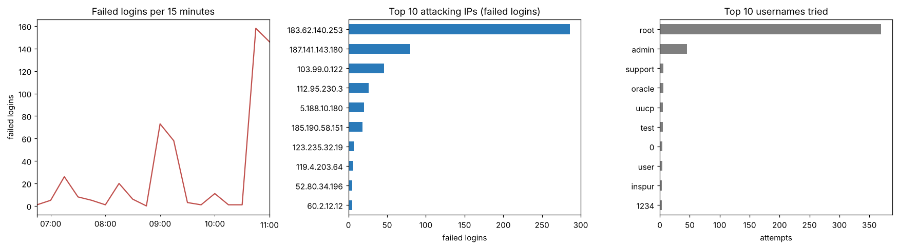

# SSH Log Security Analysis - Brute-Force Detection in Python

A small detection tool that reads a Linux SSH server log, turns each line into a structured event, and runs **SIEM-style detection rules** to flag brute-force attacks, username enumeration, suspicious successful logins and spoofed hosts. Each alert is mapped to a **MITRE ATT&CK** technique and written up as an incident report.



## Results on a real server log (2,000 lines, ~4 hours)

- **524 failed logins from 24 IPs**; **71% targeted `root`**.
- **113** attempts used usernames that don't exist (`admin`, `oracle`, `test`, `ubuntu`…), a sign of automated scanning.
- One IP, **183.62.140.253**, made **286 failed attempts**, peaking at 279 within 10 minutes.
- **20 alerts:** 9 HIGH (brute force), 6 MEDIUM (username enumeration), 4 LOW (reverse-DNS mismatch), 1 INFO (a successful login with no earlier failures from that IP, so not flagged as a compromise).

Full write-up: [`output/report.md`](output/report.md) · all alerts: [`output/alerts.csv`](output/alerts.csv)

## Detection rules

| # | Rule | Logic | Severity | MITRE ATT&CK |
|---|---|---|---|---|
| 1 | Brute-force login | ≥ 5 failed logins from one IP within 10 minutes (rolling window) | HIGH | T1110.001 Password Guessing |
| 2 | Username enumeration | ≥ 3 different non-existent usernames from one IP | MEDIUM | T1110 Brute Force |
| 3 | Success after failures | Successful login from an IP with ≥ 3 earlier failures | CRITICAL | T1078 Valid Accounts |
| 4 | Reverse DNS mismatch | sshd's "POSSIBLE BREAK-IN ATTEMPT" warning | LOW | T1036 Masquerading |

Thresholds are function parameters, so they can be tuned for a busier or quieter server.

## How it works

1. **Parse** (`src/parser.py`): regular expressions split each syslog line into timestamp, host, process ID and message, then classify the message into one of 11 event types (failed password, invalid user, accepted login…) and pull out the username and source IP.
2. **Detect** (`src/detections.py`): pandas groups events by IP and applies the rules above (rule 1 uses a 10-minute rolling window).
3. **Report** (`analyze.py`): writes `events.csv`, `alerts.csv`, a Markdown incident report with recommended fixes, and charts.
4. **Test** (`tests/`): 8 unit tests check the parser and each rule, including that slow, spread-out failures do *not* trigger the brute-force rule.

## How to run

```bash
pip install -r requirements.txt
python analyze.py                       # analyze the sample log
python analyze.py /var/log/auth.log --year 2026   # or your own server's log
pytest                                  # run the tests
```

## Data

`data/OpenSSH_2k.log`: 2,000 lines of a real OpenSSH server log from [Loghub](https://github.com/logpai/loghub) (Zhu et al., *Tools and Benchmarks for Automated Log Parsing*, ICSE 2019), a public collection of system logs for research. Syslog lines have no year, so the tool takes it as an option.

## Ideas to extend

- GeoIP lookup of attacking IPs and a map
- Export alerts in a format a SIEM can ingest (e.g. JSON for Splunk or Elastic)
- Generate fail2ban or firewall block rules automatically from HIGH alerts

## Repository structure

```
├── data/OpenSSH_2k.log      sample log
├── src/parser.py            log line -> structured event
├── src/detections.py        detection rules
├── analyze.py               command-line entry point
├── tests/test_analyzer.py   unit tests (pytest)
├── pytest.ini               test settings
├── output/                  events.csv, alerts.csv, report.md
├── images/attack_overview.png
└── requirements.txt
```

* [LinkedIn](https://www.linkedin.com/in/mmudabbirahmed)*
